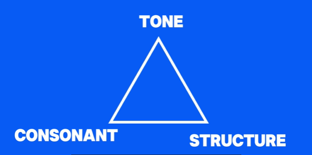

## My Story
> And the best thing about this method?  
> Once you know it, you can never unlearn it.  
> It exists within you.

> Kind of like riding a bike or whatever experience that you have had before.  
> Like, you know, the experience of walking with your clothes on in the rain  
> That's an experience that you have in your body that's never going to go away.  

```txt
And so I'm sharing my story with you, because I want you to know that you are not alone, wherever
you are in your voice Journey.
I was probably way, way lower than that.
```

## About this course(Please don't skip this!)

```txt
This course is based on the principle that the voice is the body.
We don't push or strain, but we rely on vocal energy, which is created using a combination of the
mind through visualization and the body.
Now, let me introduce to you the concept of the triangle of vocal energy.
```



1. Find room - As speaking will be involved
2. Voice over Techniques

```txt
So these are specific tools that are technical and that you can apply immediately.
So it's very helpful if you have practice scripts which I will provide because it is through the doing
and the practicing and application of the techniques that you will watch your voice gain.
```

3. Knowledge
   1. **Lectures** - So for this you can just be on the train or on the bus listening to this. So you may want to take notes if you like, but it's not necessary. Most of the time just listening to them is enough.
   2. **Assignments** - So this is for you to test your knowledge and what you have absorbed, and also be able to encourage you to put in the practice and to do the exercises.